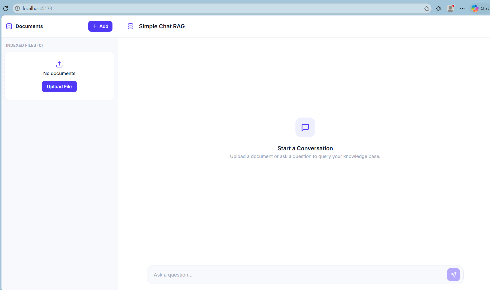

# Simple Chat RAG

```
Frontend/   React (Vite) chat UI
Backend/    FastAPI + LangChain + LangGraph + FAISS + Groq + Guardrails AI
```

## Setup (Windows PowerShell)

Backend (Python 3.10+; Python 3.12 was used for testing):
```powershell
cd Backend
python -m venv .venv
.\.venv\Scripts\Activate.ps1
pip install -r requirements.txt
Copy-Item .env.example .env        # then edit .env and set GROQ_API_KEY
# optional: stop Guardrails sending anonymous metrics
guardrails configure --disable-metrics
uvicorn app.main:app --reload --port 8000
```
The first start downloads the HuggingFace embedding model (needs internet, a few hundred MB with torch).
If `Activate.ps1` is blocked: `Set-ExecutionPolicy -Scope Process Bypass`.

Frontend (second terminal, Node 18+):
```powershell
cd Frontend
npm install
npm run dev            # http://localhost:5173  (proxies /api to http://localhost:8000)
```

## Example requests
```powershell
curl.exe -F "file=@C:\path\policy.pdf" http://localhost:8000/api/upload
curl.exe http://localhost:8000/api/documents
curl.exe -X POST http://localhost:8000/api/chat -H "Content-Type: application/json" `
  -d '{\"question\":\"What is the attendance policy?\",\"conversation_id\":\"demo1\"}'
curl.exe -X DELETE http://localhost:8000/api/chat/demo1      # clear that conversation
```
Chat response: `{"answer": "...", "sources": ["policy.pdf"], "grounded": true, "conversation_id": "demo1"}`

## How it works
- **Ingestion** (`vectorstore.py`): PDF/TXT -> LangChain `PyPDFLoader`/`TextLoader` -> `RecursiveCharacterTextSplitter`
  -> HuggingFace embeddings (normalised) -> one shared **FAISS** index (inner product = cosine), metadata
  `source`, `chunk`, `page`. Saved to `Backend/data/faiss` automatically and reloaded on start (no env var).
- **Workflow** (`graph.py`, **LangGraph**): `validate_input -> resolve_question -> retrieve_documents ->
  check_relevance -> [generate_answer -> validate_output] -> return_response`. A conditional edge after
  `check_relevance` skips generation entirely and returns the fixed fallback when evidence is missing.
- **Relevance**: chunks must reach a cosine threshold (`RELEVANCE_THRESHOLD`, `config.py`) *and* a Groq judge
  must confirm the excerpts actually contain the answer. The answer prompt also forbids outside knowledge.
- **Memory**: LangGraph `MemorySaver` checkpointer keyed by `conversation_id` (thread), holding LangChain
  messages. Only the last 6 messages reach the LLM, and only validated, document-grounded turns are stored.
  Memory only rewrites follow-ups into standalone questions; retrieval and relevance still run every time.
- **Guardrails AI** (`guards.py`): two `Guard`s with custom validators built on the Guardrails API.
  Input: non-empty, <=1000 chars, prompt-injection phrases. Output: non-empty, no key leakage, no cited
  filename that isn't a retrieved source, and a lexical support check against the retrieved context.
  No Guardrails Hub validators are used (they need a Hub token).
- **Groq**: `langchain-groq` `ChatGroq` (temperature 0); auth, rate-limit, timeout and other errors map to
  401->502 / 429 / 504 / 503 with generic messages; details only in the server log.

## Tests
```powershell
cd Backend; pytest
```
**Executed here: 16 passed.** They run the real LangGraph, FAISS, loaders, splitter, Guardrails validators and
FastAPI routes, but use a keyword embedding model and a scripted LLM, so they are offline.
**Not executed:** anything against real Groq, the real HuggingFace model, or the React UI in a browser
(no credentials/network in my environment). Run a manual upload-and-ask check with your key.
Covered: TXT and PDF answers, unrelated question, missing info, similar-but-insufficient, follow-up,
empty question, empty collection, LLM failure (504), failed output validation, conversation isolation,
memory not bypassing relevance, bad upload types.

## Known limitations
- Memory is in-process: restarting the server clears conversations (documents persist).
- The output "support" check is lexical, so it is a safety net, not proof of faithfulness.
- Tune `RELEVANCE_THRESHOLD` (0.30) for your embedding model and documents.
- Scanned PDFs without a text layer are rejected (no OCR).
- Each question costs up to 3 Groq calls (rewrite on follow-ups, relevance judge, answer).

## Frontend
The Frontend/ folder is the UI you asked for, created new in this project. Routes it calls:
`GET /api/documents`, `POST /api/upload`, `POST /api/chat`.




